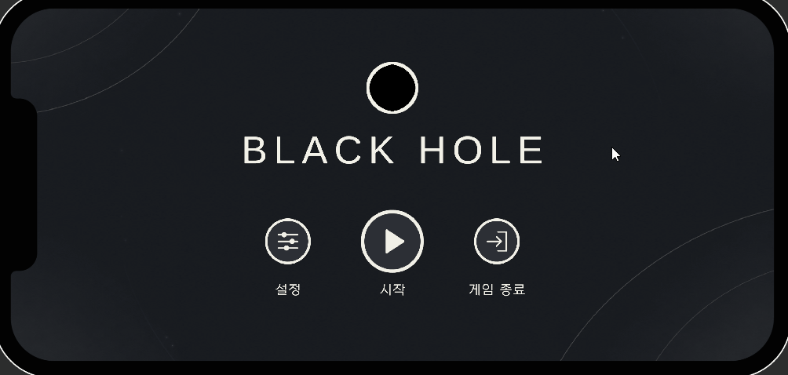
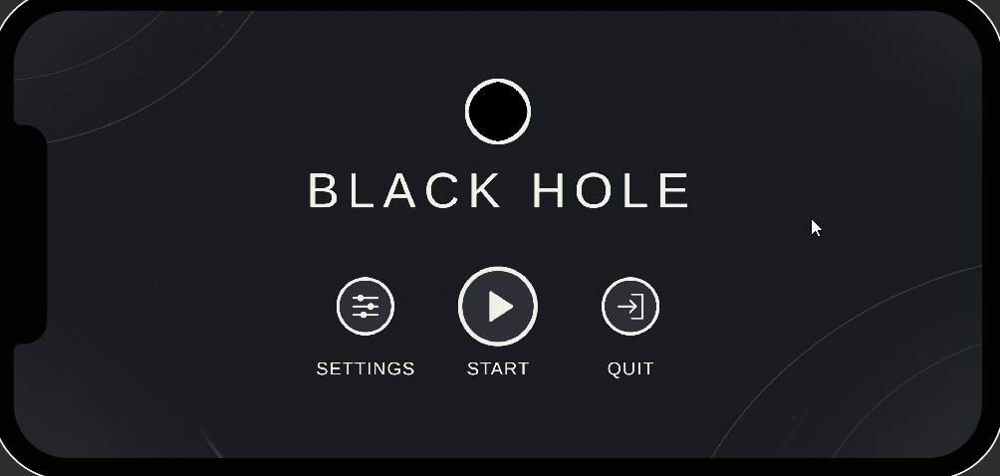
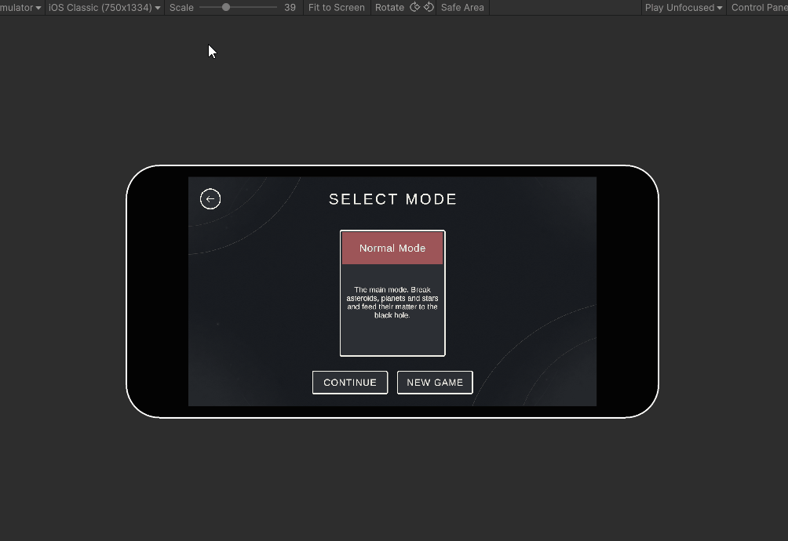
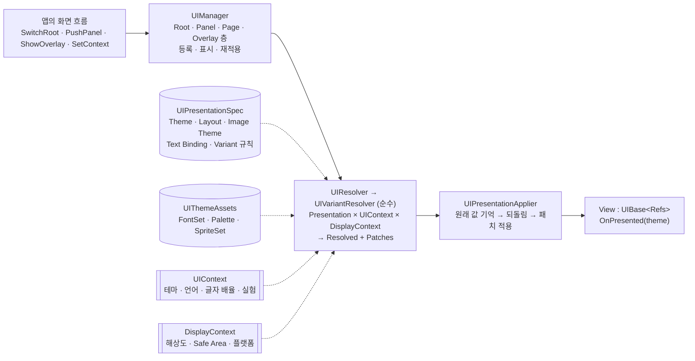

# UIPresentationFlow

**Unity uGUI 화면의 "흐름"과 "표현"을 나누는 UI 프레임워크**

화면 코드는 *무엇이 있고 무슨 일이 일어나는지*만 알고, *어떻게 보이는지*(테마·언어·글자 크기·화면비별 레이아웃·Safe Area·스프라이트)는 데이터(ScriptableObject)와 순수 함수인 Resolver가 정한다.

`Unity 6000.6.2f1` · `uGUI + TextMeshPro` · `C#` · 프레임워크 약 6,400줄 · 2025-12 ~ (149 커밋)
실사용: Android 증분형 게임 **블랙홀 키우기**의 화면 11개 전부

| 설정이 바뀌면 보이는 화면이 그 자리에서 다시 적용된다 | 화면 흐름: Root → Panel 쌓기 → 확인 창 → Overlay |
|:--:|:--:|
|  |  |

| 기기(노치·펀치홀·폴더블·태블릿)가 바뀌어도 같은 프리팹이 Safe Area와 화면비에 맞춰진다 |
|:--:|
|  |

---

## 어떤 문제를 푸나

화면 수가 늘면 같은 화면 코드 안에 이런 분기가 쌓인다.

```csharp
// 흔한 화면 코드
if (settings.DarkMode) background.sprite = darkSprite; else background.sprite = lightSprite;
title.font = locale == "ko-KR" ? koreanFont : latinFont;
title.fontSize = 48 * settings.TextScale;
if (Screen.width / (float)Screen.height > 2.0f) buttons.anchoredPosition = wideLayout;
safeAreaRoot.anchorMin = Screen.safeArea.min / new Vector2(Screen.width, Screen.height);
```

이 분기는 화면마다 같은 일을 조금씩 다르게 하고, 디자이너가 바꿀 값(그림·글꼴·색·위치)이 코드에 묶이며, 설정이 바뀌었을 때 열려 있는 화면을 어떻게 갱신할지가 화면마다 다르다.

UIPresentationFlow는 이 결정을 **데이터 + 순수 함수**로 옮긴다. 화면 코드는 버튼이 눌렸다는 사실만 알리고, 위의 다섯 줄은 Presentation 에셋과 공유 디자인 에셋, Resolver가 맡는다.

```csharp
// 같은 화면, UIPresentationFlow
public sealed class TitleScreen : UIRoot<TitleScreen.Refs>
{
    public enum Refs { StartBtn_Button, SettingsBtn_Button, SafeAreaRoot, Title_Text, Background_Image }

    public event Action StartClicked;

    protected override void OnInitialize() =>
        ButtonFeedback.Bind(View.Button(Refs.StartBtn_Button), () => StartClicked?.Invoke());
}
```

## 구조



| 층 | 역할 | 코드 |
|---|---|---|
| **View** | `UIBase<TRefs>`. `Refs` 열거형의 이름 = 프리팹 자식 이름(계약). `View.Button(Refs.X)`처럼 꺼내 쓰고, 사건을 알린다. 코드로 만든 글자·그림은 `Styled`에 등록 | `Scripts/UI` |
| **UIManager** | 네 층의 수명과 표시. Root(한 장) · Panel(쌓임: 아래 창은 흐려지고 입력을 받지 않으며, 정한 깊이를 넘으면 꺼진다. Panel이 열린 동안 Root도 키보드·패드 입력을 받지 않고, 닫으면 연 순간의 포커스로 돌아간다) · Page(Owner 안의 교체 영역, Owner가 닫히면 같이 닫힘) · Overlay(쌓이지 않음, 여럿 동시에 — 알림·엔딩). 컨텍스트·디스플레이가 바뀌면 보이는 것만 다시 적용 | `Scripts/UI/UIManager.*.cs` |
| **Presentation** | 화면 하나가 *어떻게 보이는지*의 데이터: 기본값 + 조건부 Variant 규칙 | `Scripts/Presentation` |
| **Resolver** | `(Presentation, UIContext, DisplayContext) → Resolved → Patch 목록`. Unity 전역 상태(`Screen`, `Application`)를 읽지 않아 같은 입력은 같은 결과. 선택 과정을 Trace로 남긴다 | `Scripts/Presentation/UIResolver.cs`, `Rules/` |
| **Applier** | 패치가 바꾸는 값(폰트·크기·색·앵커·그림·버튼 상태 그림)의 원래 값을 기억했다가, 다시 적용할 때 먼저 되돌린다. 테마를 오가도 값이 누적되지 않는다 | `Scripts/Presentation/Patches` |
| **Display** | 해상도·Safe Area·플랫폼의 스냅샷(`DisplayContext`)과 화면비 등급(Compact·Standard·Wide·UltraWide). 해상도가 바뀌면 `UIDisplayRefreshDriver`가 다시 적용 | `Scripts/Display` |
| **Localization** | CSV 한 장(`key, en-US, ko-KR …`). 프리팹 글자는 `{화면 이름}.{Ref 이름}` 키로 자동 치환 | `Scripts/Localization` |

## 핵심 설계

### Presentation — 화면이 어떻게 보이는지의 데이터

`UIPresentationSpec` 하나가 화면 하나의 표현이다. 프리팹이나 라우팅은 고르지 않는다(그건 앱의 일).

| 항목 | 내용 |
|---|---|
| `ThemeSpec` | 글자 역할(Title·Body·Caption)별 크기. 실제 크기 = 역할 크기 × 사용자 글자 배율. 자동 크기 글자는 이 값을 최대로 삼는다 |
| `LayoutPatchSpec` | `refId`로 가리킨 위젯의 앵커·피벗·위치·크기·활성 여부 덮어쓰기 |
| `UIImageThemeSpec` | 테마별 그림. 버튼의 올림·누름·막힘 그림(Sprite Swap)까지 바꾼다 |
| `UITextBindingCatalog` | 글자마다 역할, 그리고 크기 고정(`fixedSize`: 로고처럼 배율을 안 받음)·글꼴 고정(`fixedFont`: 번역 안 하는 로고) |
| `UIVariantRule[]` | 조건이 맞으면 위 항목을 덮어쓴다. **항목마다** 우선순위가 가장 높은 규칙이 이긴다(테마는 A 규칙, 레이아웃은 B 규칙에서 올 수 있다) |

`VariantCondition`은 테마 · 언어 · 플랫폼 · 화면비 등급 · 화면비 범위 · 실험 배정을 AND로 묶는다. 비워 두면 "상관없음"이다. 모든 입력이 `Matches(ui, display)`의 인자라 플레이어 없이도 검사할 수 있다.

### 공유 디자인 에셋 — 한 곳만 바꾼다

| 에셋 | 내용 |
|---|---|
| `UIFontSet` | 언어 × 역할별 글꼴. 없는 언어는 첫 줄로 대체 |
| `UIPalette` | 테마별 색 6가지(글자 강·약, 강조, 표면, 선, 배경) |
| `UISpriteSet` | 기본 그림 → 테마별 변형. 화면이 따로 Image Theme을 갖지 않아도, 코드로 만든 그림이어도 변형이 적용된다 |

### UIContext — 사용자 선택은 통째로 바꾼다

테마 · 언어 · 글자 배율 · 실험 배정 · QA용 강제 Variant를 담는 불변 구조체. `UIManager.SetContext`로 바꾸면 보이는 Root·Panel·Page·Overlay가 그 자리에서 다시 적용되고, 숨은 화면은 다음에 열 때 적용된다. 첫 번째 GIF가 이것이다.

### 코드로 만든 요소도 같은 테마를 받는다

목록 줄을 복제하거나 코드로 만든 글자·그림은 `Styled.AddText(text, UITextRole.Body)`·`Styled.AddSprites(row)`·`Styled.AddImageColor(image, UIColorRole.Backdrop)`로 등록하면 프리팹 요소와 같은 패치를 받는다. 항목마다 자기 원래 값을 갖고 있어 다시 적용해도 누적되지 않는다. 그 밖에 화면이 직접 그리는 것(머티리얼, 계산한 색)은 `OnPresented(in UIAppliedTheme)`에서 받은 글꼴·색·그림으로 맞춘다.

### 데이터 키와 계약 검사

- 바인딩 에셋은 화면을 `UIViewKey.Of(type)`(기본: 타입 짧은 이름)로 가리킨다. 네임스페이스·폴더를 옮겨도 에셋이 이어지고, 클래스 이름을 바꿔야 하면 `[UIViewKey("…")]`로 고정한다. 두 화면이 한 키를 쓰면 등록할 때 예외.
- `UIRefCheck`: 화면을 등록할 때 `Refs`에 있는데 프리팹에 없는 자식을 경고한다(에디터와 `UNITY_ENABLE_CHECKS` 빌드).
- `SafeAreaRoot`라는 자식이 있으면 `DisplayContext`의 Safe Area에 절대값으로 맞춘다. 누적되지 않고, Layout Patch의 대상이 아니다.

### 버튼 사건

`UI_EventHandler`가 EventSystem 콜백을 일관된 사건으로 바꾼다: 드래그·길게 누름은 클릭을 막고, 들어감/나감은 항상 짝이며(비활성화되면 나감을 보냄), `Selectable`이 막혀 있으면 클릭을 보내지 않는다. 끌기를 받는 쪽이 없는 버튼은 끌기를 부모(스크롤 목록 등)에 넘긴다 — 목록 안의 버튼 위에서 끌어도 목록이 끌린다. `ButtonFeedback.Bind` 한 줄이 클릭 처리 + 크기 연출 + 소리(앱이 `IButtonSounds`로 넣음)를 묶는다.

## 사용법

**1. 조립** — 시작 컨텍스트와 공유 에셋으로 UIManager를 만들고 화면을 등록한다.

```csharp
var context  = new UIContext("Dark", "ko-KR", textScale: 1f);
var resolver = new UIResolver(context, new UIThemeAssets(fonts, palette, sprites));
var ui       = new UIManager(rootLayer, panelLayer, resolver, new UIPresentationApplier(), overlayLayer: overlayLayer);

foreach (UIBase view in views)
    ui.Register(view);                 // 키 중복·Refs 누락은 여기서 바로 알린다

var localizer = new Localizer(csv.text, "ko-KR");
var texts     = new ViewTexts(views, localizer);   // 프리팹 글자를 표의 글자로
```

**2. 흐름** — 어느 화면을 언제 여는지는 앱 코드가 정한다. 화면은 서로를 모른다.

```csharp
ui.SwitchRoot<TitleScreen>(titlePresentation,
    afterPresented: root => root.StartClicked += OpenModeSelect,
    afterClosed:    root => root.StartClicked -= OpenModeSelect);

ui.PushPanel<SettingsPanel>(settingsPresentation);                 // 지금 화면 위에 쌓인다
ui.PopPanel();
ui.ShowOverlay<NoticeOverlay>(noticePresentation).Show("저장되었습니다", 3f);
```

**3. 설정이 바뀌었다** — 컨텍스트를 바꾸면 보이는 화면이 즉시 다시 적용된다.

```csharp
ui.SetContext(ui.Context.With("Light", "en-US", textScale: 1.2f));
localizer.SetLocale("en-US");
```

**4. 화면을 만든다** — 프리팹 자식 이름을 열거형으로 선언하고, 사건만 알린다.

```csharp
public sealed class SettlementScreen : UIRoot<SettlementScreen.Refs>
{
    public enum Refs { Row_Template, Total_Text, ContinueBtn_Button, SafeAreaRoot }

    public event Action ContinueClicked;

    protected override void OnInitialize() =>
        ButtonFeedback.Bind(View.Button(Refs.ContinueBtn_Button), () => ContinueClicked?.Invoke());

    public void ShowRows(IReadOnlyList<Row> rows)
    {
        foreach (Row row in rows)
        {
            var clone = Instantiate(View.Rect(Refs.Row_Template), View.Rect(Refs.Row_Template).parent);
            Styled.AddSprites(clone);                                  // 테마별 그림
            Styled.AddText(clone.GetComponentInChildren<TMP_Text>(), UITextRole.Body);   // 글꼴·크기·색
        }
    }

    protected override void OnPresented(in UIAppliedTheme theme) =>
        _lineMaterial.color = theme.ColorFor(UIColorRole.Line) ?? _lineMaterial.color;   // 코드로 그리는 것
}
```

## 데모

### 블랙홀 키우기 UI 데모 — `Assets/Demo/BlackHole/`

출시를 준비 중인 게임 **블랙홀 키우기**의 실제 화면 7개(타이틀 · 모드 선택 · 설정 · 일시 정지 · 확인 창 · 알림 · 엔딩)를 게임 규칙 없이 옮겨 온 데모. 화면 스크립트·프리팹·Presentation·Binding은 게임 파일 그대로이고(GUID도 같다), 데모 전용은 조립(`BlackHoleDemoBootstrap`)과 흐름(`BlackHoleDemoFlow`)뿐이다. 즉 "프레임워크 위의 화면은 게임을 떼어 내도 그대로 동작한다"는 증명이다.

**실행**: 메뉴 **UI Demo > Build BlackHole Demo Scene** → `Assets/Demo/BlackHole/Scenes/BlackHoleDemo` 플레이. 메뉴가 한글 글꼴을 데모 글자만 정적 아틀라스로 굽고, 씬(캔버스·층·화면·참조)을 코드로 만든다.

| 해 볼 것 | 확인되는 것 |
|---|---|
| 설정 → 다크 모드 · 언어 · 글자 크기 | `SetContext`: 테마 그림·색, 번역, 언어별 글꼴, 글자 배율이 열린 창에서 그대로 바뀜 (GIF 1) |
| 시작 → 모드 선택 → 새 게임 → 확인 → 엔딩 | Panel 쌓기, 모달 확인 창, Overlay가 화면을 덮고 끝나면 화면 전환으로 타이틀 (GIF 2) |
| Device Simulator에서 기기 변경 | `SafeAreaRoot`와 화면비 대응 (GIF 3) |
| 모드 선택 → 계속 | 입력을 막지 않는 Overlay 알림 |
| Esc | 상태마다 한 가지만: 엔딩 건너뛰기 · 맨 위 창 닫기 · 창이 없으면 일시 정지 |
| 일시 정지 → 설정 | 창 위에 창(아래 창 흐림·입력 차단) |
| 설정 → 음량 | 버튼 소리(ButtonFeedback) |

### Adaptive UI 데모 — `Assets/Scenes/AdaptiveUIDemo`

비주얼 노벨 형태의 화면(타이틀 · 게임플레이 · 앨범 · 시스템 메뉴의 저장/불러오기 **Page**). Root·Panel·Page 흐름과 화면비 등급별 레이아웃 Variant(Compact · Wide · UltraWide), Image Theme, Text Binding을 보여 준다. 다른 프로젝트에서 화면을 만들 때 참고하도록 다듬는 중이다.

## 에디터 도구 — `Tools/UI Presentation/…`

| 메뉴 | 하는 일 |
|---|---|
| `Text Bindings/Scan Selected UI` · `Create or Sync Selected UI` | 고른 화면 프리팹의 글자를 찾아 보이고, Text Binding(역할) 에셋을 만들거나 프리팹에 맞춰 갱신 |
| `Text Bindings/Validate Catalog` | 카탈로그 검사(없는 Ref, 중복) |
| `Image Bindings/Scan Selected UI` · `Create or Sync Binding` | 고른 화면 프리팹의 그림을 찾아 보이고, 테마별 Image Binding 에셋을 만들거나 갱신 |
| `Image Bindings/Sync Selected Theme Folder` | Image Theme의 Binding마다 그 폴더에서 Ref 이름과 같은 스프라이트를 찾아 연결 — 그림 파일 이름만 맞추면 테마가 채워진다 |
| `Image Bindings/Validate Selected Theme` | Image Theme 검사 |
| `Check View Keys` | 화면 데이터 키 중복, 없는 화면을 가리키는 Binding(스크립트를 다시 읽을 때마다 중복은 자동 검사) |

## 실사용: 블랙홀 키우기

6인 팀 프로젝트(클라이언트 리드)로 만든 Android 증분형 게임. 모든 화면 11개(타이틀 · 모드 선택 · 설정 · 일시 정지 · 확인 · 알림 · 엔딩 · 전투 HUD · 결산 · 업그레이드 · 노드 트리)가 이 프레임워크 위에서 동작한다.

- 라이트/다크 테마, 한국어/영어, 글자 크기 50~150%를 설정에서 바꾸면 즉시 반영
- 버튼 연출·소리를 `ButtonFeedback` 한 길로, 화면 전환(아이리스)을 공용 부속으로 통일
- 게임에서 생긴 것들을 이 레포로 되돌렸다: Overlay 층, 공유 디자인 에셋(FontSet·Palette·SpriteSet), 코드 요소 스타일(Styled), 버튼 상태 그림 테마, 현지화, 데이터 키, 공용 연출·위젯

## 실사용: ked-presentation-runtime

비주얼 노벨 연출 런타임의 예제 UI 화면 12개(Root 2 · Panel 6 · Page 4)를 이 프레임워크 위에 다시 세웠다. 프레임워크는 복사해 들였고(원본과 차이 0), 화면은 C# **빌드 명세**로 정의해 빌더가 그 프로젝트의 Unity로 프리팹을 짓는다 — AI가 화면 스크립트와 명세를 쓰고, 개발자가 Unity에서 검수했다. 화면 하나의 코드 · 프리팹 · 그림 · Presentation을 한 묶음으로 둔다.

- 원칙으로 정리한 것: [docs/AUTHORING.md](docs/AUTHORING.md) — 명세가 원본, 프리팹은 산출물, 화면 묶음, 특수 화면, 검사, 배포, 사람의 역할
- 이 레포로 되돌린 것: 버튼 위 끌기를 목록에 넘기기, Panel 아래 Root 입력 막기, Panel을 닫으면 포커스 되돌리기, 복사 안내(아래 "요구 사항"). 범위와 다음 일은 [docs/PLAN_from-ked.md](docs/PLAN_from-ked.md)

## 설계 결정

- **결정은 순수하게.** Variant 선택은 `Screen`·`Application`을 읽지 않고 `DisplayContext` 스냅샷을 받는다. 같은 입력은 어느 기기에서든 같은 결과이고, `TraceEnabled`를 켜면 왜 그 Variant를 골랐는지 줄 단위로 남는다. 출시 빌드에서는 끈다.
- **되돌릴 수 있게.** 패치는 바꾸기 전 값을 기억한다(글자는 폰트·크기·자동 크기 최대값, 그림은 스프라이트·색·Sprite Swap 상태). 테마·언어·배율을 오가도 값이 누적되지 않는다. "역할 크기 × 배율"처럼 항상 원값에서 계산한다.
- **우선순위는 항목별로.** 규칙 하나가 전체를 덮어쓰지 않는다. 테마는 "다크" 규칙에서, 레이아웃은 "UltraWide" 규칙에서 각각 가장 높은 것을 고른다.
- **화면은 사건만 알린다.** 다음에 어디로 갈지는 앱의 흐름 코드가 정한다. 화면 클래스는 다른 화면을 모르고, 그래서 게임 밖 데모로 그대로 옮겨진다.
- **프리팹 이름이 계약.** `Refs` 열거형과 자식 이름이 1:1이고, 어긋나면 등록할 때 바로 알린다. 바인딩 에셋도 같은 이름을 쓴다.
- **화면비는 등급으로.** 규칙마다 숫자를 적지 않고 `DisplayLayoutClassifier`의 네 등급을 쓴다. 문턱값이 한 곳에 있어 정책을 바꿔도 규칙은 그대로다.
- **공유 값은 한 곳에.** 글꼴·색·스프라이트 변형은 `UIThemeAssets` 하나. 화면의 ThemeSpec에는 역할 크기만 남는다.
- **화면은 명세로 짓는다.** 화면 스크립트와 빌드 명세가 원본이고, 프리팹은 빌더가 그 프로젝트의 Unity로 만드는 산출물이다. AI도 사람도 프리팹의 직렬화 데이터를 손으로 쓰지 않고, 사람은 결과를 보고 판정한다. 명세로 나타내기 어려운 화면만 프리팹을 직접 만들되 같은 `UIBase<TRefs>`와 같은 검사를 쓴다 — [docs/AUTHORING.md](docs/AUTHORING.md)

## 폴더

```text
Assets/
├─ Scripts/
│  ├─ UI/             UIManager(Root·Panel·Page·Overlay), UIBase<TRefs>, UIContext, 사건 배선, Safe Area, 데이터 키·Refs 검사
│  │  ├─ Animations/  화면 전환(아이리스), 버튼 연출·피드백, 연출 곡선, 튕김, 막대 채움, 숫자 올리기
│  │  └─ Widgets/     코드 UI 도우미, 끌기·확대 뷰, 행 툴팁
│  ├─ Presentation/   Spec, Resolver, Variant 규칙, Patch(Theme·Layout·Image), Text/Image Binding, Styled, 공유 디자인 에셋
│  ├─ Display/        DisplayContext, 화면비 등급, 해상도 변화 감지
│  ├─ Localization/   Localizer(CSV), ViewTexts
│  └─ Demo/           Adaptive UI 데모 코드
├─ Editor/UI/         Binding 스캐너·빌더·검사, View Key 검사
├─ Shaders/           화면 전환 아이리스
├─ Demo/
│  ├─ AdaptiveUI/     Adaptive UI 데모 에셋
│  └─ BlackHole/      블랙홀 키우기 UI 데모(화면·프리팹·에셋·흐름·씬 빌더)
└─ UI/                Adaptive UI 데모의 Binding·Theme 에셋
```

## 요구 사항

- Unity **6000.6.2f1**, `com.unity.ugui` 2.6.0(TextMeshPro 포함)
- 블랙홀 데모: Input System 1.20.0, URP 17.6.0(배경 셰이더)

UPM 패키지가 아니다. 다른 프로젝트에서는 `Scripts/UI` · `Scripts/Presentation` · `Scripts/Display` · `Scripts/Localization` · `Scripts/UIPresentationFlow.Runtime.asmdef` · `Editor/UI` · `Shaders`를 복사해 쓴다. 데모 폴더는 필요 없다. 코드는 Unity 6000.3(ugui 2.0)에서도 컴파일된다(ked-presentation-runtime에서 확인).

복사할 때(ked-presentation-runtime에서 겪은 것):

- **폴더 층을 그대로 둔다** — `Scripts/`와 `Editor/`가 형제여야 한다. `Scripts/` 층을 걷어 런타임 asmdef를 위로 올리면 `Editor/UI`가 그 asmdef 아래로 들어가는데, Unity는 asmdef 아래의 `Editor` 폴더를 에디터 전용으로 보지 않는다. 에디터 코드가 런타임 어셈블리에 섞여 플레이어 빌드가 깨진다.
- **`.meta`째 복사한다** — GUID가 원본과 같아야 화면 프리팹의 스크립트 참조가 이어진다.
- **asmdef는 고치지 않는다**(`autoReferenced: true`). 들이는 프로젝트에 같은 전역 이름(`UIBase` · `UIManager` 등)이 이미 있으면 그쪽을 먼저 걷는다.
- **에셋은 내리지 않는다** — 이 레포(6000.6)에서 직렬화한 프리팹·에셋을 낮은 버전으로 옮기지 않는다. 코드와 셰이더만 들이고 에셋은 그 프로젝트에서 만든다.
- **원본 커밋의 blob을 풀어 `diff -r`로 차이 0을 확인한다.** 작업 트리에는 커밋하지 않은 변경이 섞일 수 있다.

## 글꼴

블랙홀 데모의 한글 글꼴은 수정하지 않은 원본이다. 본문 **넥슨 Lv1 고딕**(ⓒ NEXON, 저작권 안내 포함 배포 조건), 제목 **나눔휴먼 Bold**(SIL Open Font License 1.1). 게임의 제목 글꼴은 재배포 제한이 있어 넣지 않았다. 자세한 내용은 `Assets/Demo/BlackHole/Fonts/FONTS_NOTICE.txt`.
